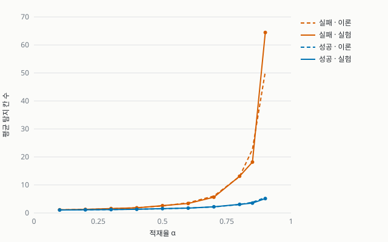

# 과제2 샘플 · URL 단축기

2026-2 **고급알고리즘**(SIT2001-01) 과제2를 수업 순서대로 끝까지 진행한
**샘플 저장소**입니다. 과제는 이 저장소가 아니라
[hw2-starter-2026](https://github.com/lec-algorithm/hw2-starter-2026)에서
**Use this template**으로 시작합니다.

- 과제 안내: [lec-algorithm.github.io/lecture/article/hw2-2026](https://lec-algorithm.github.io/lecture/article/hw2-2026/)
- 수업 슬라이드: [lec-algorithm.github.io/lecture/slides/hw2-2026](https://lec-algorithm.github.io/lecture/slides/hw2-2026/)

## 단계별 태그

수업의 일곱 단계가 끝난 상태마다 태그가 붙어 있습니다. 수업 중 놓친 단계는
본인 저장소에서 `sh tools/catchup.sh <단계 번호>`로 따라잡습니다.

| 태그 | 단계 | 더해진 것 |
| --- | --- | --- |
| `step-1` | 채팅과 에이전트 비교 | `src/base62.py`, `tests/test_base62.py` |
| `step-2` | 명세 쓰기 | `SPEC.md` |
| `step-3` | 계획 먼저 받기 | `PLAN.md` |
| `step-4` | 테스트 먼저, 구현은 에이전트 | `src/hash_table.py`, `src/shortener.py`와 테스트 |
| `step-5` | 규칙은 파일로 | `.github/copilot-instructions.md` |
| `step-6` | 결과는 직접 검증 | `experiments/` (적재율 실험과 그래프) |
| `step-7` | 서비스로 띄우기 | `src/server.py`와 테스트 |

## 돌려 보기

컨테이너 안(Codespaces 터미널)에서 실행합니다.

| 하고 싶은 것 | 명령 |
| --- | --- |
| 테스트 | `make test` |
| 웹 서버 (포트 8000) | `make serve` |
| 충돌 실험 | `make experiment` |

## 실험 결과

크기 4093인 테이블에 무작위 URL을 넣고 들여다본 칸 수를 센 결과입니다.
점선은 주제 08의 크누스 근삿값입니다.

